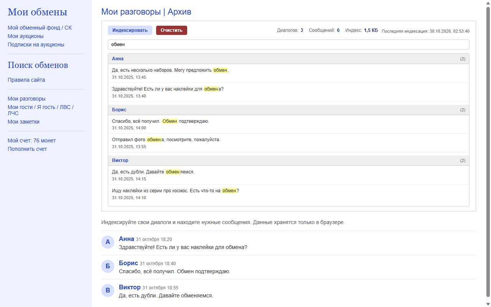

<p align="center">
  
</p>

<h1 align="center">LastSticker Search</h1>

<p align="center">
  Локальный поиск по сообщениям в ваших диалогах на <a href="https://laststicker.ru">laststicker.ru</a>
</p>

<p align="center">
  <a href="https://github.com/lavandiI/laststicker-search/actions/workflows/ci.yml"></a>
  <a href="https://github.com/lavandiI/laststicker-search/releases/latest"></a>
  <a href="LICENSE"></a>
  
</p>

<p align="center">
  <a href="https://lavandii.github.io/laststicker-search/">Сайт</a> ·
  <a href="https://lavandii.github.io/laststicker-search/privacy.html">Конфиденциальность</a> ·
  <a href="https://github.com/lavandiI/laststicker-search/releases">Релизы</a> ·
  <a href="https://github.com/lavandiI/laststicker-search/issues">Поддержка</a> ·
  <a href="CHANGELOG.md">CHANGELOG</a>
</p>

<p align="center">
  
</p>

**LastSticker Search** — расширение Chrome (Manifest V3), которое индексирует ваши собственные диалоги и темы форума на `laststicker.ru` и помогает находить нужные сообщения за секунды. Индексы хранятся локально в браузере и никуда не отправляются.

## Возможности

| Возможность | Что делает |
| --- | --- |
| **Поиск по всем диалогам** | Ищет по тексту сообщений и именам собеседников в основной и архивной переписке. |
| **Переход к сообщению** | Открывает нужную страницу диалога в текущей вкладке и подсвечивает найденное сообщение целиком. |
| **Поиск внутри диалога** | На странице `/users/my_talks/{id}/` ищет только по этому разговору и показывает число сообщений. |
| **Поиск по форуму** | Отдельная панель на страницах форума: индексация темы, поиск по комментариям и переход к точному сообщению. |
| **Глобальный поиск по форуму** | Ищет по всем темам, которые уже проиндексированы, и группирует результаты по темам. |
| **Инкрементальная индексация** | При повторном запуске пропускает диалоги с неизменившимся счётчиком и докачивает новые страницы темы. |
| **Прогресс и отмена** | Показывает, сколько диалогов или страниц темы обработано, и позволяет остановить длинную индексацию. |
| **Локальное хранение** | Диалоги хранятся в `chrome.storage.local`, форум — в IndexedDB; данные не уходят на внешние серверы. |
| **Встроенная панель** | Работает прямо на странице сайта, без отдельных окон и переключения вкладок. |
| **Клавиатура** | Стрелки выбирают результат, Enter открывает, `/` фокусирует поиск. |
| **Автообновление** | После первого полного индекса каждые 6 часов обновляет его, если нет непрочитанных сообщений. |
| **Контроль индекса** | Показывает размер индекса, предупреждает об устаревании и ошибках загрузки. |
| **Включение и отключение** | Клик по иконке расширения включает и выключает его. |

<p align="center">
  
</p>

## Установка

### Chrome Web Store

Публикация готовится. После прохождения ревью расширение можно будет установить из магазина, и Chrome будет обновлять его автоматически.

### Вручную из ZIP

1. Скачайте `laststicker-search-1.5.0.zip` со [страницы последнего релиза](https://github.com/lavandiI/laststicker-search/releases/latest).
2. Распакуйте архив в отдельную папку.
3. Откройте `chrome://extensions/` и включите **режим разработчика**.
4. Нажмите **«Загрузить распакованное расширение»** и выберите папку, где лежит `manifest.json`.

### Из исходников

```bash
git clone https://github.com/lavandiI/laststicker-search.git
cd laststicker-search
git checkout v1.5.0
```

Далее загрузите папку через `chrome://extensions/` → «Загрузить распакованное расширение».

## Как пользоваться

1. Откройте страницу `/users/my_talks/` на `laststicker.ru`.
2. Нажмите **«Индексировать»** — начнётся сбор и сохранение сообщений.
3. Введите текст или имя собеседника в строку поиска — результаты обновятся автоматически.
4. Откройте отдельный диалог, если нужно искать только внутри него.
5. Используйте **«Показать ещё»** для больших выборок.
6. Кнопка **«Очистить»** полностью удаляет индекс диалогов из локального хранилища.

Поиск по форуму:

1. Откройте тему на `/blog/post{id}/`.
2. Нажмите **«Индексировать тему»** — комментарии сохранятся в IndexedDB.
3. Ищите по тексту или автору. В конкретной теме поиск идёт только по этой теме; на главной странице форума — по всем проиндексированным темам.
4. Клик по результату открывает нужную страницу темы и подсвечивает комментарий.
5. **«Обновить»** докачивает новые страницы. Чтобы собрать тему заново, нажмите **«Очистить»** на странице темы и проиндексируйте её снова. На странице темы «Очистить» удаляет только эту тему, на главной форума — все проиндексированные темы.

Индексация запускается только вручную. Новые сообщения попадают в поиск после повторного нажатия «Индексировать» или «Обновить».

## Конфиденциальность

- Текст сообщений, имена собеседников, даты и идентификаторы диалогов хранятся только в `chrome.storage.local`.
- Комментарии форума, авторы, даты, названия тем и идентификаторы хранятся только в IndexedDB расширения (`laststicker-search-forum`).
- Нет аналитики, рекламы и внешних серверов.
- Данные не продаются и не передаются третьим лицам.
- Расширение не запрашивает доступ к истории просмотров и не читает вкладки других сайтов.
- Автообновление диалогов включено по умолчанию, работает раз в 6 часов и пропускается, если есть непрочитанные сообщения.
- Автообновление диалогов не работает при закрытом браузере.
- Форум индексируется вручную; полный обход форума не выполняется.
- Индекс диалогов удаляется кнопкой «Очистить» в панели диалогов. На странице темы кнопка «Очистить» удаляет только эту тему, на главной форума — весь форумный индекс. Удаление расширения удаляет оба индекса.

Подробнее: [политика конфиденциальности](https://lavandii.github.io/laststicker-search/privacy.html) · [PRIVACY.md](PRIVACY.md).

## Разработка

Требуется Node.js 20.19 или новее.

```bash
npm install      # установка зависимостей
npm run lint     # ESLint, без предупреждений
npm test         # Jest, 92 теста
npm run package  # ZIP для Chrome Web Store в dist/
npm run format   # Prettier
```

Релиз: пуш тега `vX.Y.Z` запускает GitHub Actions, проверяет версии, собирает ZIP и прикладывает его к Release.

Структура проекта:

```text
manifest.json           # Manifest V3
background.js           # service worker: индексация и сетевые запросы
content.js              # content script: парсинг страниц и подсветка
inline-panel.js         # встроенная панель: поиск и навигация
inline-ui.js            # отрисовка панели
inline-storage.js       # chrome.storage.local и миграция
inline-styles.css       # стили панели
fetch-retry.js          # таймауты и повторы сетевых запросов
parser.js               # общий парсер страниц диалогов
forum-parser.js         # парсер форума
forum-storage.js        # IndexedDB-хранилище форума
forum-indexer.js        # offscreen-индексатор форума
indexer.js              # offscreen-индексатор диалогов
offscreen.html          # offscreen-документ
icons/                  # иконки 16–128 px
scripts/                # сборка ZIP для Chrome Web Store
tests/                  # unit-тесты Jest и HTML-фикстуры
docs/                   # сайт и политика для GitHub Pages
store/                  # материалы для Chrome Web Store
```

## Ограничения

- Расширение работает только с `laststicker.ru` и `www.laststicker.ru`; канонический хост — `www.laststicker.ru`.
- При индексации открываются страницы диалогов, поэтому сайт может отметить их прочитанными. Если это важно, индексируйте архив (`/users/my_talks/hide/`) — он уже прочитан.
- Повторная индексация пропускает диалоги с неизменившимся счётчиком сообщений. Для полного обновления очистите индекс.
- Первая индексация большого архива может занять несколько минут; прогресс и отмена доступны в панели.
- Поиск по форуму охватывает только темы, которые вы уже проиндексировали. Полный обход всех тем не выполняется автоматически.
- Большая тема форума может содержать тысячи страниц; индексация такой темы занимает время и место в IndexedDB. Прогресс и отмена доступны в панели.
- Расширение не связано с администрацией laststicker.ru.

## Лицензия

[MIT](LICENSE) © 2026 lavandil
